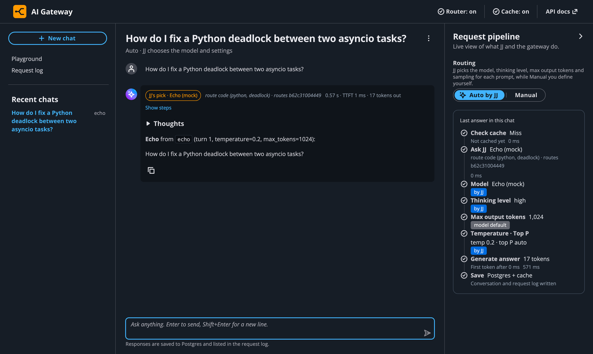
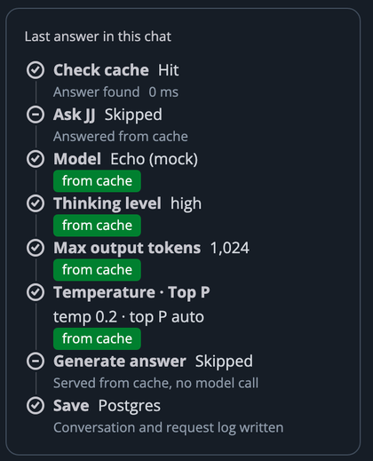
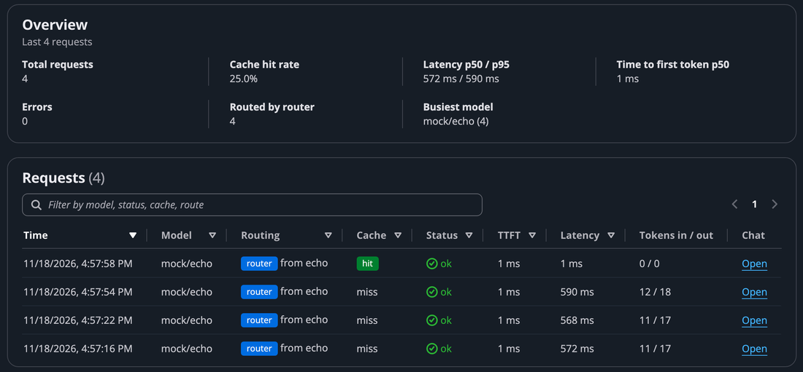

# Custom AI Gateway

A self-hosted gateway between a chat UI and LLM providers (Anthropic, OpenAI, Gemini, Ollama, or an offline mock). Every prompt goes through **cache → router → provider**, and each request is logged to Postgres.



## What it does

- **Smart routing ("JJ")**: in *Auto* mode, the router picks the model, thinking level, max tokens and sampling for each prompt. In *Manual* mode, you pick them yourself.
- **Caching**: repeated prompts are answered from the cache, with no router or model call.
- **Live pipeline view**: every step is streamed to the UI and labelled *by JJ*, *by you*, *model default* or *from cache*.
- **Request log**: cache hit rate, p50/p95 latency, TTFT and tokens for every call.
- **Fail-open plugins**: if the router or cache errors or times out, the chat still works.

| Cache hit, step by step | Request log |
|---|---|
|  |  |

## Quick start

```bash
cd gateway
cp .env.example .env          # add any API keys you have (optional)
docker compose up --build     # Postgres + gateway + UI → http://localhost:8090
```

No API key? Pick **Echo (mock)** in Run settings.

**Local dev** (hot reload):

```bash
cd gateway && docker compose up -d postgres
uv sync && uv run uvicorn gateway.main:app --port 8090 --reload
cd ../web && npm install && npm run dev       # http://localhost:5173
```

**Turn on the built-in router and cache** in `gateway/.env`:

```bash
GATEWAY_ROUTER_CLASS=gateway.plugins.rules_router:RulesRouter   # rules in routes.yaml
GATEWAY_CACHE_CLASS=gateway.plugins.redis_cache:RedisCache      # needs GATEWAY_REDIS_URL
```

## Layout

```
gateway/   FastAPI backend: pipeline, providers, plugins, routing, evals, tests
web/       React + Cloudscape UI
```

## Tests

```bash
cd gateway && uv run pytest -q    # no keys, Postgres or Redis needed
```

See [gateway/README.md](gateway/README.md) for the full docs: writing your own router/cache plugin, the model catalog, the API and the database schema.
